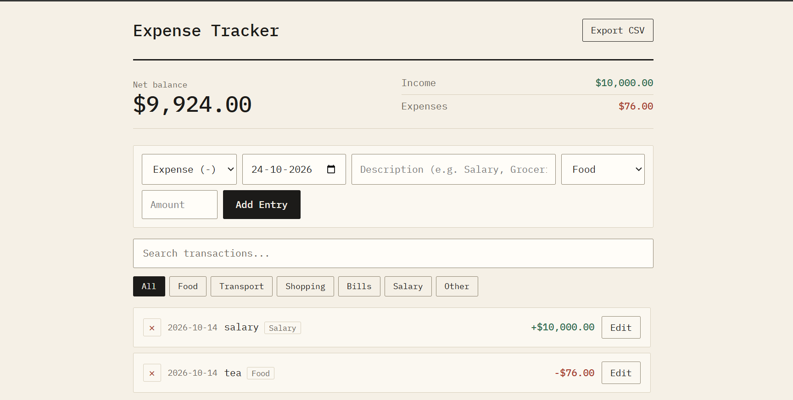

# 💸 Expense Tracker

> Track your income and expenses, filter and search transactions, and export everything to CSV. A full-stack app built with React and Express.




**Live demo:** [https://react-expense-tracker-silk-eight.vercel.app/](https://react-expense-tracker-silk-eight.vercel.app/)

---

## ✨ Features

- ➕ **Add, edit and delete** transactions (full CRUD)
- 💰 **Income and expense** types with automatic totals and a **net balance** card
- 🏷️ **Categories**: Food, Transport, Shopping, Bills, Salary, Other
- 🔎 **Live search** by description and **category filter chips**
- 📅 Newest transactions shown first
- 📤 **Export to CSV** with one click
- 💾 Data stored on the server, so it survives refreshes and browser changes

## 🛠️ Tech Stack

| Layer | Technology |
|---|---|
| Frontend | React (hooks, component-based UI), CSS |
| Backend | Node.js, Express |
| Storage | JSON file (`server/expenses.json`) |

## 🧱 Architecture

```
React (:3000)  ──/api/expenses──▶  Express (:5000)  ──▶  expenses.json
```

React keeps the UI state (form, filter, search, totals). Every add, edit and delete is sent to the Express API first, then reflected on screen.

## 📁 Project Structure

```
expense-tracker/
├─ public/
├─ server/
│  ├─ index.js              # Express REST API
│  └─ package.json
├─ src/
│  ├─ components/
│  │  ├─ SummaryCards.jsx   # Income, expenses, balance
│  │  ├─ EntryForm.jsx      # Add / edit form
│  │  ├─ FilterBar.jsx      # Search + category chips
│  │  ├─ ExpenseList.jsx    # List and empty message
│  │  └─ ExpenseItem.jsx    # One transaction row
│  ├─ App.jsx               # State, server calls, filtering
│  ├─ App.css
│  └─ utils.js              # Helpers and CSV export
└─ package.json
```

## 🚀 Getting Started

### Prerequisites

- [Node.js](https://nodejs.org/) 18 or newer

### Installation

```bash
# 1. Install frontend dependencies
npm install

# 2. Install backend dependencies
cd server
npm install
cd ..
```

### Run the app

Open **two terminals**:

```bash
# Terminal 1: backend (http://localhost:5000)
cd server
node index.js

# Terminal 2: frontend (http://localhost:3000)
npm start
```

The frontend forwards `/api/*` requests to the backend using the `"proxy"` setting in the root `package.json`.

## 🔌 API Reference

| Method | Endpoint | Description |
|---|---|---|
| `GET` | `/api/expenses` | List all transactions |
| `POST` | `/api/expenses` | Create a transaction (the server assigns the `id`) |
| `PUT` | `/api/expenses/:id` | Update a transaction |
| `DELETE` | `/api/expenses/:id` | Delete a transaction |

**Transaction shape**

```json
{
  "id": 1760000000000,
  "type": "expense",
  "date": "2026-10-14",
  "itemName": "Groceries",
  "category": "Food",
  "money": 25.5
}
```

## ⚠️ Known Limitations

- No user accounts: all data is shared by anyone using the server
- A JSON file is used instead of a real database to keep the backend minimal
- No error message is shown yet if a server request fails

## 🗺️ Roadmap

- [ ] Error handling and messages for failed requests
- [ ] Move storage to MongoDB
- [ ] Register / login with JWT, so each user has their own transactions
- [ ] Monthly charts and budget limits
- [ ] Deploy (frontend on Vercel, backend on Render)

## 👤 Author

Built by **Piyush** as part of a self-taught journey into full-stack web development.